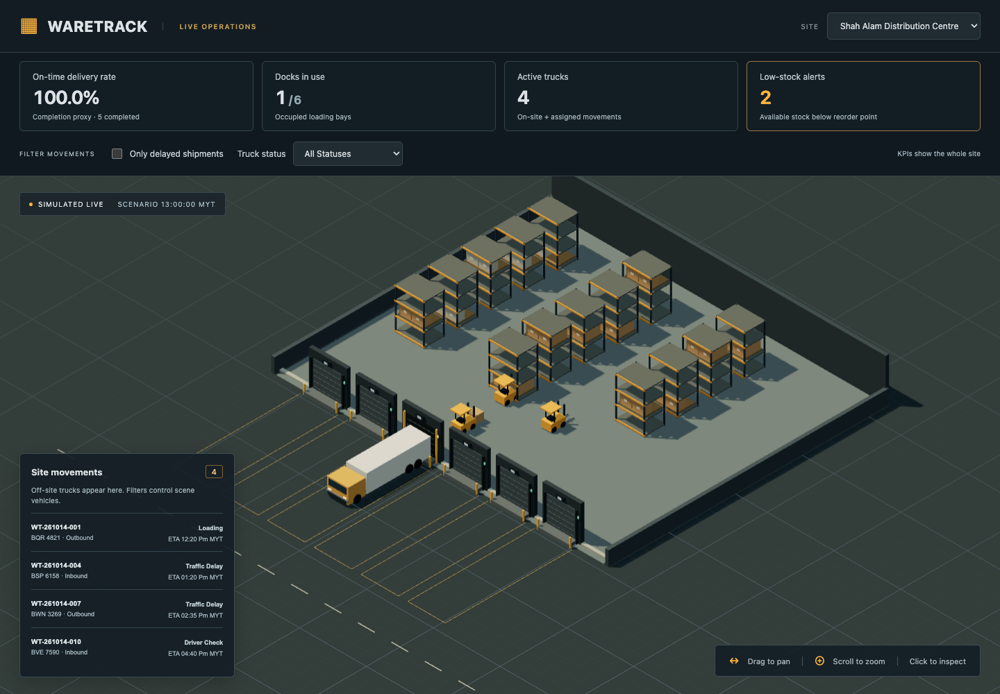

# 3D Warehouse Dashboard

**WareTrack** is an interactive warehouse operations dashboard that brings the feel of a real-time strategy game to logistics management. Explore low-poly warehouses from an isometric camera, inspect trucks and forklifts, and track site performance through live status panels and operational KPIs.

Built with **TypeScript, React, React Three Fiber, drei, and Zustand**, the project is a working frontend prototype with realistic seed data and simulated telemetry. Its dark industrial interface uses amber highlights to make selection, alerts, and controls easy to spot.



## Features

- **Three warehouse sites:** Shah Alam, Penang, and Johor, with smooth camera travel between sites and support for reduced-motion preferences.
- **Interactive 3D scene:** loading docks, on-site trucks, forklifts, shelving, and stock cartons rendered as low-poly geometry with shadows and a grid floor.
- **Strategy-game navigation:** mouse-drag panning, wheel zoom, and camera limits that account for the visible map area.
- **Object inspection:** click an object to highlight it and view its name, state, current shipment, and last update time. Close the panel or press Escape to clear selection.
- **Simulated live updates:** truck and forklift telemetry changes every two seconds without replacing the scene or resetting its camera.
- **Site KPIs:** on-time completion proxy, docks in use, active trucks, and low-stock alerts.
- **Combined filters:** show overdue shipments and filter trucks by their current telemetry status. The movement list includes off-site trucks.
- **Responsive controls:** a desktop operations view with layouts for smaller screens.

## Getting started

Use Node.js 22.12 or later and npm. A browser with WebGL support is required.

```bash
git clone https://github.com/kengcc/3D-Warehouse-Dashboard.git
cd 3D-Warehouse-Dashboard
npm ci
npm run dev
```

Open the local address printed by Vite, normally `http://127.0.0.1:5173/`.

| Command | Purpose |
| --- | --- |
| `npm run dev` | Start the development server |
| `npm test` | Run placement, instancing, camera, store, KPI, and filter tests |
| `npm run typecheck` | Run strict TypeScript checks, including unused declarations |
| `npm run test:browser` | Run browser interaction, resource, and renderer-budget regressions |
| `npm run build` | Type-check the project and build production files in `dist/` |
| `npm run preview` | Preview the production build locally |

The renderer uses local geometry and text textures; it does not download models, fonts, or HDR environments at runtime.

## Exploring the dashboard

1. Choose a warehouse in the top bar. The camera flies to that site's location.
2. Drag to pan and scroll to zoom. Click a dock, truck, forklift, shelving frame, or stock carton to inspect it; clicking warehouse walls or the floor inspects the site.
3. Read the four KPI cards for the selected site. Their totals remain site-wide when filters are applied.
4. Enable **Only delayed shipments**, select a **Truck status**, or combine both. Use **Clear filters** to restore all active movements.
5. Select a movement from the list to inspect its truck, including trucks that are scheduled or in transit and therefore absent from the physical scene.

Filters affect the movement list and matching scene vehicles. Warehouse infrastructure stays visible for orientation. Site changes clear selection; a vehicle's selection also clears if a telemetry update causes it to stop matching the active filters.

## Data model

The deterministic seed snapshot contains **3 sites, 18 docks, 12 trucks, 8 forklifts, 40 inventory records, and 25 shipments**. All six entity types and their relations are defined in `src/data/`.

| Entity | Relationships |
| --- | --- |
| Site | Owns docks, forklifts, and inventory through `siteId` |
| Dock | Belongs to a site and references its active loading shipment |
| Truck | References its active shipment and its current site when physically on-site |
| Forklift | Belongs to a site and can reference its assigned shipment |
| InventoryItem | Records a SKU, stock quantities, and an aisle/rack/level/bin at a site |
| Shipment | Connects a site, truck, optional dock, and inventory lines; includes arrival/departure ETAs and completion information |

Scene placement comes from these relationships: dock numbers determine bay positions, active shipment assignments position vehicles, and inventory locations position shelving and cartons. Warehouses occupy separate **schematic** locations in the scene; those locations do not represent geographic distances. Cartons summarize stock quantity rather than representing every unit.

## KPI definitions

| KPI | Calculation |
| --- | --- |
| On-time delivery rate | **Warehouse-completion proxy:** completed shipments with a known completion time at or before planned departure, divided by completed shipments with known completion times. No completed outcomes displays a dash. |
| Docks in use | Occupied docks at the selected site, out of all its docks |
| Active trucks | Trucks physically at the site or assigned to its active shipments, excluding idle or maintenance telemetry states. Scheduled movements are included. |
| Low-stock alerts | Inventory records where on-hand stock minus reserved stock is below the reorder point |

Actual delivery timestamps are not present in the current model, so the on-time card is explicitly labelled as a completion proxy. The dashboard does not claim a measured last-mile delivery SLA.

An active shipment is overdue when the scenario clock exceeds its arrival ETA before arrival is recorded, or its departure ETA after arrival is recorded. A traffic-delay telemetry phase alone does not establish that an ETA has been missed. The delayed and truck-status filters combine with **AND**.

## Architecture

```text
src/
  data/                 Entity types and deterministic seed records
  store/                Zustand state, simulation lifecycle, and domain selectors
  features/warehouse/   Store-connected scene adapter, KPIs, filters, movement list, status panel
  scene/                3D geometry, selection visuals, layout helpers, and camera controls
  main.tsx              Application composition and simulation startup
  style.css             Dark industrial theme and responsive layout
```

Repeated warehouse parts are batched into instanced meshes with shared geometry, materials, and a dock-label atlas. Instance IDs preserve object picking; selected outlines are batched separately. Rendering runs on demand, and static shadow maps update only when the camera or geometry changes. Business decisions, KPI calculations, shipment resolution, and simulated state transitions belong in the store and application layer. Scene components receive derived layouts and selection callbacks and handle rendering, pointer gestures, and camera movement.

## Simulation and scope

The operational scenario begins at **14 October 2026, 13:00 Malaysia time** and advances two seconds on each simulation tick. Vehicle telemetry update timestamps use the actual wall clock, while static objects retain their snapshot or inventory update time. Both are displayed in Malaysia time.

Telemetry phases such as waiting, inspection, and positioning are separate from the shipment lifecycle. Simulation does not change shipment assignments, seed records, inventory quantities, or physical vehicle positions. Its timer is cleaned up when the application unmounts.

This prototype has no external warehouse backend, authentication, or persistent storage. Reloading restores the seed scenario. Production integration should replace the simulated telemetry with a real data source and add actual delivery timestamps before reporting a delivery SLA.

## Verification and development workflow

Automated tests cover data-derived placement, camera ground-plane bounds, immutable seed data, telemetry updates and cleanup, object details, KPI scope, ETA boundaries, and combined filters. The current interface has also been checked in a browser for selection, persistent canvas/camera state, smooth and rapid site changes, filter results, mobile fit, and reduced-motion navigation.

For future code changes, run the relevant checks, commit the completed changes, and push to this repository. Project-specific instructions are recorded in `AGENTS.md`.


### Browser checks

Install a browser once with `npx playwright install chromium`, then run `npm run test:browser`. To use an installed Chrome instead, run `WARETRACK_BROWSER_CHANNEL=chrome npm run test:browser`. The test runner starts a local development server when one is not already running.

The suite checks instanced object selection, live panels, shader/browser errors, GPU resource cleanup, idle rendering, camera flights, wheel/pan bounds, combined filters, mobile resizing, reduced motion, and renderer budgets. Frame timing attachments include the GPU and viewport; they report observed FPS rather than asserting a universal hardware-dependent frame rate. See `docs/code-review.md` for the latest engineering review and measured results.
